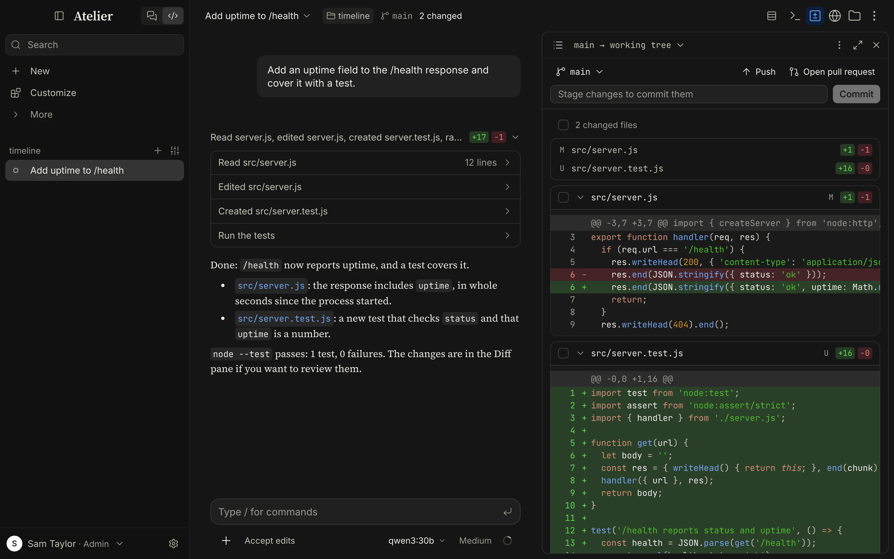
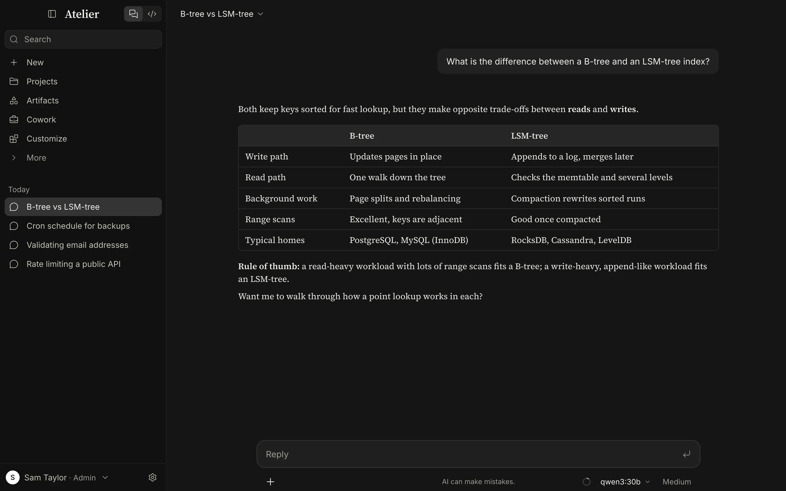
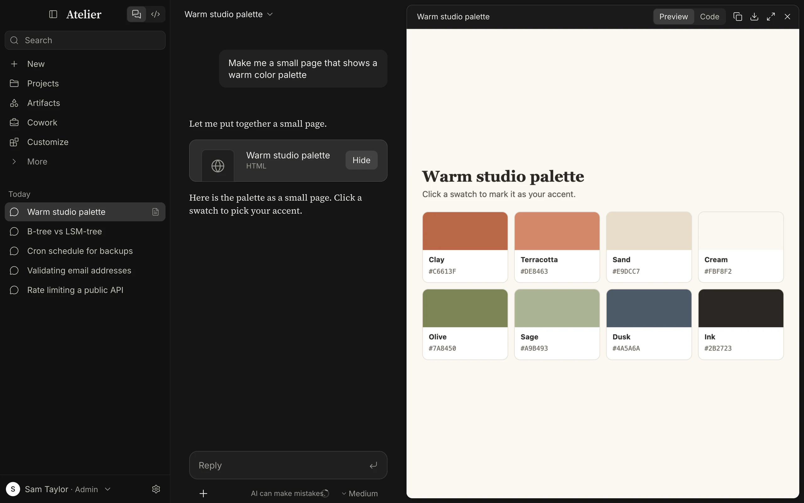
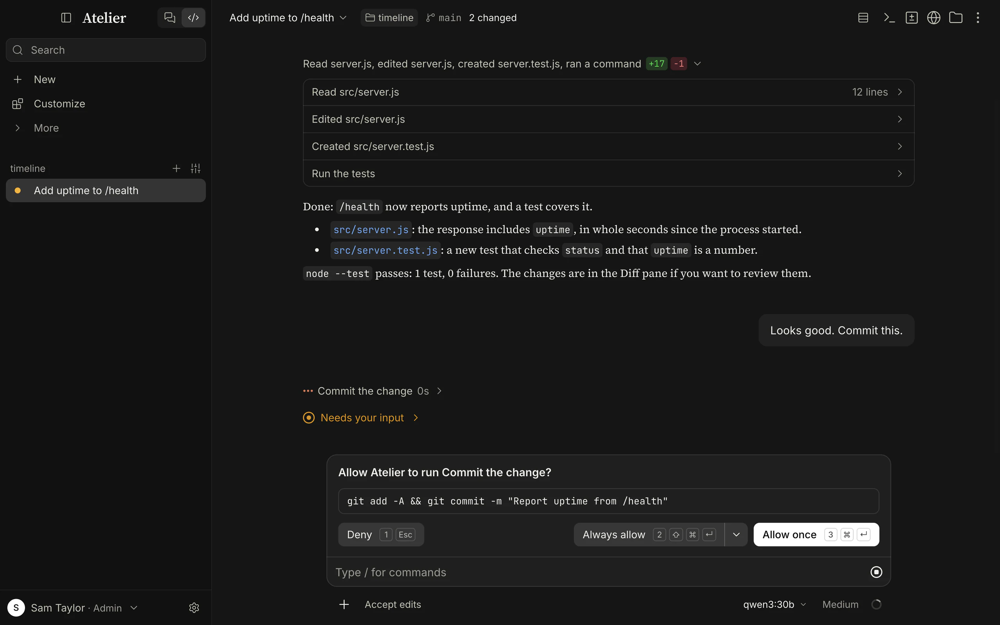
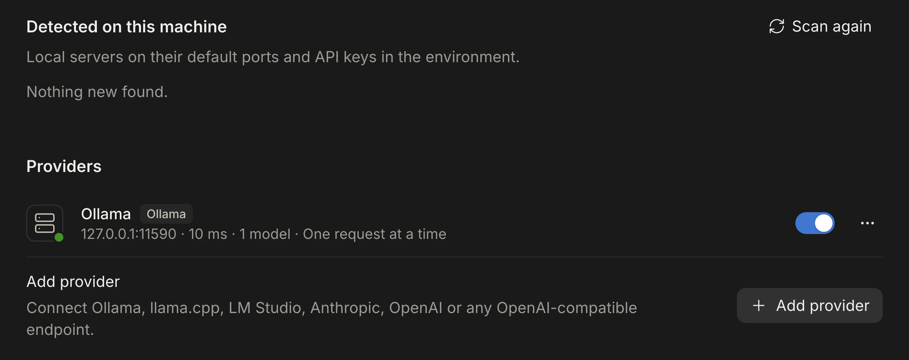
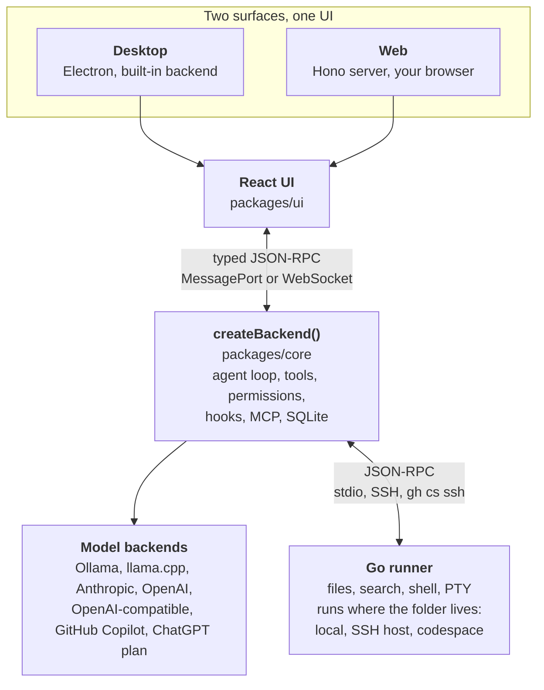

<div align="center">


# Atelier

**A self-hosted AI workspace with Chat, Cowork and Code, on the models you choose.**

Run it on your own machine with Ollama or llama.cpp, or use Anthropic, OpenAI, GitHub Copilot, a ChatGPT plan, OpenRouter or any OpenAI-compatible endpoint.<br>
One backend, two ways in: a desktop app and a web app you host yourself.

<br>

[](#status)
[](#install)
[](#self-hosting)
[](#models-and-providers)
[](#license)
[](#your-data)
[](#install)

<br>

**[Docs](https://docs.atelierhq.dev)** &nbsp;·&nbsp; **[Features](#features)** &nbsp;·&nbsp; **[Install](#install)** &nbsp;·&nbsp; **[First run](#first-run)** &nbsp;·&nbsp; **[Models](#models-and-providers)** &nbsp;·&nbsp; **[Self-hosting](#self-hosting)** &nbsp;·&nbsp; **[Prompts](#how-it-talks-to-models)** &nbsp;·&nbsp; **[Architecture](#architecture)** &nbsp;·&nbsp; **[Development](#development)** &nbsp;·&nbsp; **[FAQ](#faq)**

<br>



<sub>A Code session in the desktop app: the conversation, its tool cards, and the diff they produced.<br>Screenshots show the real interface running against a scripted demo model.</sub>

</div>

<br>

> [!WARNING]
> **Atelier is in beta.** Features are still missing, behavior changes between versions, and some things break.

## What is Atelier?

Atelier is a workspace for language models. Three modes share one conversation model, one set of settings and one backend:

- **Chat** for conversations, with artifacts, projects, attachments and web research.
- **Cowork** for longer tasks in a folder that end in files you can open.
- **Code** for agentic sessions in a folder. Tool names and permission rules follow Claude Code's, so rules, hooks and skills written for it mostly carry over.

It runs on the models *you* choose, keeps everything in a data folder you control, and reads Claude Code's skills, plugins, commands, agents, hooks and `CLAUDE.md` where they already are, and can import its MCP config.

> **About the project.** Atelier is an independent project, not affiliated with or endorsed by Anthropic or OpenAI.

<br>

## Features

### Chat

<table>
<tr>
<td width="60%" valign="top">



</td>
<td width="40%" valign="top">

- **Rich replies**: Markdown, tables, syntax-highlighted code and math.
- **Attachments**: drop, paste or add (`⌘U` / `Ctrl+U`) images, PDFs and text files.
- **Web search**: built in and on by default; the **Research** switch makes a conversation search broadly and cite its sources.
- **Memory**: lasting preferences and facts about you carry across chats. You can read and delete every entry and tell Atelier what to change; editing by hand is an admin setting. Temporary chats are left out.
- **Reasoning effort**: Low to Max, changeable mid-conversation (a model with no setting of its own is guided by a short note; ChatGPT Chat takes the steps of ChatGPT's own picker). Models that can only think on or off get a **Thinking** switch.
- **Editable history**: retry a reply or edit your message and the earlier versions stay, one click away.
- **Long chats stay usable**: conversations are compacted automatically before they outgrow the context window, and the line it leaves opens the summary.
- **Context meter**: how full the window is; in Code a popover breaks it down by category and shows what a ChatGPT plan has left or what a session cost on a hosted API.
- **Projects**: chats that share instructions and files.

</td>
</tr>
</table>

### Artifacts

<table>
<tr>
<td width="40%" valign="top">

When a reply builds something, it opens beside the conversation.

- HTML pages, React components, SVGs, diagrams and documents.
- **Preview, code and versions** in one panel; copy or download.
- **Sandboxed**: an artifact can't reach your account, your storage or the network.
- The **Artifacts** page lists everything your chats made, newest first.

</td>
<td width="60%" valign="top">



</td>
</tr>
</table>

### Code

<table>
<tr>
<td width="60%" valign="top">



</td>
<td width="40%" valign="top">

Read, Write, Edit, Glob, Grep and Bash, plus a task list, questions to you, sub-agents and plan mode. You choose how much it may do:

- **Auto** (the default): ordinary work in the folder goes ahead. Whatever would otherwise ask is judged by a separate review request to the session's own model, which allows it, blocks it, or hands the decision to you.
- **Ask permissions**: asks before edits and commands.
- **Accept edits**: edits freely, still asks before commands.
- **Plan mode**: reads, searches and plans; edits and every Bash command are refused until you approve a plan.
- **Bypass permissions**: runs without asking. Your deny and ask rules still apply.

`Shift+Tab` cycles Auto, Ask, Accept edits and Plan; Bypass is chosen from the menu. Dangerous commands (`rm -rf` outside the folder, `sudo`, `curl … | sh`, force pushes) ask in Ask permissions and Accept edits even when an allow rule matches. In Auto the reviewer decides, except that deleting outside the folder still asks you. See [Permissions](https://docs.atelierhq.dev/permissions/).

</td>
</tr>
</table>

| | |
|---|---|
| **Work where the code lives** | A folder on this computer, a machine over **SSH** (your keys and `~/.ssh/config` work as with `ssh`), or a repository in a **GitHub codespace** (implemented, not yet verified against a real account). With **No folder**, each session gets a scratch folder of its own. |
| **Review and undo** | The **Diff** pane compares against the last commit, what is staged, the branch's start, or just what the session changed. Stage, commit, push and open a pull request; **Reject** a single hunk. **Rewind** restores files, the conversation, or both. |
| **Watch and steer** | Type while it works: your message joins at the next step, or **Send now** interrupts. `/loop 5m check the deploy` repeats a prompt on a schedule. Sub-agents can run in the background. |
| **Panes** | **Terminal**, **Diff**, **Browser** (desktop: your dev server or docs), **Files** and **Background tasks**, docked beside the conversation, resizable and remembered per session. Any pane can go **fullscreen**. |
| **Several sessions at once** | **Split view** puts up to four sessions side by side. Keys and typing go to the one you click into; a session picked in the sidebar replaces it, and **New** puts a fresh session in its place. Drag the dividers to resize. |
| **Keep sessions organized** | Your own **groups**, **archive**, **fork** a conversation, **mark as unread**. The sidebar's view options group by folder, date, state or your groups, sort, and filter by status and environment. A session's dot shows when it needs you or a turn finished while you were elsewhere. |
| **Open it elsewhere** | **Open in** (desktop): a new window with only that session, Cursor, VS Code or Finder. Atelier reopens in the tab (Chat or Code) you left it in. |
| **Ultracode** | The top effort stop: the model plans, has sub-agents investigate in parallel and others check the results. Slower and far more tokens, so admins can switch it off. |

### Cowork

Cowork works through a longer task in a folder and leaves the files it makes there. Pick a folder, describe the task and watch its steps beside the conversation. It ends with cards for the files it wrote, and a system notification tells you when it finishes, fails or needs you while you are in another window.

### Extensible, and compatible with Claude Code

Atelier reads many of Claude Code's files where they already are, so a project set up for Claude Code mostly works as it is. [What is and isn't supported](https://docs.atelierhq.dev/claude-code-compatibility/) is in the docs.

| | On this computer | In a project |
|---|---|---|
| **Skills** | `~/.agents/skills`, `~/.claude/skills`, `~/.atelier/skills` | `.agents/skills`, `.claude/skills`, `.atelier/skills` |
| **Commands** | `~/.claude/commands`, `~/.atelier/commands` | `.claude/commands`, `.atelier/commands` |
| **Sub-agents** | `~/.claude/agents`, `~/.atelier/agents` | `.claude/agents`, `.atelier/agents` |
| **Instructions** | `~/.claude/CLAUDE.md` (desktop) | `ATELIER.md`, `AGENTS.md`, `CLAUDE.md`, `CLAUDE.local.md`, `.claude/rules/*.md` |

- **Skills** install from GitHub (`owner/repo`); on the desktop they go into the shared `~/.agents/skills`, so other agents see them too, and new ones show up without a restart.
- **Plugins** from marketplaces, and **hooks** in Claude Code's format (`PreToolUse`, `PostToolUse`, `UserPromptSubmit`, `SessionStart`, `Stop`).
- **Connectors** are MCP servers: Cloudflare, GitHub, Notion, Linear, Brave Search, Home Assistant or any other. Paste a token or sign in with OAuth; each tool can be set to Ask, Always allow or Block. Claude Code's MCP config (`~/.claude.json`, `.mcp.json`) is imported once, not read live (**Import from Claude Code**, desktop).

### Accounts and security

- The first account is the admin; people join with an **invite code**, or by approved sign-up if an admin opens it. Browsers can use **passkeys**.
- Provider keys and tokens are **encrypted at rest**; after saving, only the last four characters are shown.
- File access goes through the runner, which resolves every path (symlinks included) and refuses anything outside the workspace's folders unless you allowed that folder.
- The web server sets a strict content-security policy and only believes `X-Forwarded-*` headers from proxies you list.

### Your data

- **Settings › Privacy**: keep conversations for a set number of days, export everything as a zip, or delete it all.
- **Settings › Usage**: tokens by day, mode and model, with cost where prices are known.
- **No telemetry.** Requests go to the model providers and connectors you configure, and to the search engines and pages web search and fetch reach. The desktop app also asks `updates.atelierhq.dev` for the latest version at start and every five minutes; **Settings › System › Check for updates automatically** turns that off. See [What leaves your machine](https://docs.atelierhq.dev/privacy/).

<br>

## What Atelier won't do

- It isn't a hosted service. There is no Atelier cloud: you run it, and you hold the data.
- The web server never runs commands on its own machine. Code in a browser works through a desktop app's folders (lent over the device link) or a GitHub codespace.
- It doesn't make a weak model strong. Small local models can struggle with tools; per-model overrides help (see [FAQ](#faq)), but quality is the model's.
- Auto mode isn't a security boundary. It reduces prompts but doesn't replace review of sensitive work.
- Rewind doesn't see Bash: shell changes aren't tracked, only file edits.
- There are no native mobile apps. The web app has a phone layout, but there is no iOS or Android client.

<br>

## Install

> [!NOTE]
> Download a build for macOS, Windows or Linux from [atelierhq.dev/download](https://atelierhq.dev/download), or build the installer for your OS from source. **The macOS builds published there are signed with a Developer ID and notarized by Apple. Windows builds are not code-signed**, so SmartScreen shows "unknown publisher" (More info › Run anyway); Linux packages are unsigned. A build you make yourself is unsigned unless you set up signing.

### Requirements

| You need | Version | Why |
|---|---|---|
| **Node.js** | 24 or newer | the app and the server |
| **pnpm** | 11 (via Corepack) | the monorepo |
| **Go** | 1.27 | builds the runner, the one binary that touches your folders |
| **Git** | any recent | repositories; the GitHub CLI `gh` is optional, for pull requests and codespaces |
| **Docker** | optional | to run the server image |
| **A model** | | for example [Ollama](https://ollama.com) |

### Desktop app, from source

```bash
git clone https://github.com/TheOriUHD/atelier.git
cd atelier
corepack enable
pnpm install
pnpm runner:build   # the Go runner; needed to open folders for Code and Cowork
pnpm dev:desktop    # Electron with hot reload
```

To build the installers for the OS you are on:

```bash
pnpm --filter @atelier/desktop package   # output in apps/desktop/release
```

Build each OS's installers on that OS (or on a machine of that OS over SSH): macOS needs a Mac, and the Windows and Linux packagers are x86-64 programs that need a native host or, on an Apple Silicon Mac, Rosetta. The build uses no native Node modules; only the Go runner is compiled per platform, and it cross-compiles from anywhere.

| Platform | Targets | State |
|---|---|---|
| macOS | `.dmg` and `.zip`, arm64 and x64 | ✅ built and used day to day. The published builds are signed with a Developer ID and notarized, so they open like any app; keep it in Applications and it updates itself in place |
| Windows | NSIS `Setup.exe` wizard, x64 and arm64 in one | ✅ built on Windows 11; silent install, uninstall and the bundled runners checked. Not signed, so SmartScreen shows "unknown publisher". The app itself has not had a full UI pass on Windows yet |
| Linux | `.deb` and `.AppImage`, x64 and arm64 | ✅ built on Ubuntu 24.04; CI starts it under a virtual display, and it has not been tried on a real desktop yet. Prefer the `.deb` (`sudo apt install ./Atelier-<version>-amd64.deb`): an AppImage needs `libfuse2t64` and, on Ubuntu 24.04, may need `--no-sandbox` |

### Updates

Installed desktop apps update themselves on every platform. A new version is looked for at start and every five minutes (**Settings › System › Check for updates automatically** switches that off), downloaded in the background, verified against the publisher's signature, and installed when you restart Atelier (a **Restart** button appears in the sidebar) or the next time you start it. Where the files come from, and how to publish a version, is in [Updates](https://docs.atelierhq.dev/updates/).

### Web app, from source

```bash
pnpm --filter @atelier/ui build
pnpm --filter @atelier/server build
node apps/server/dist/server.mjs   # http://127.0.0.1:7340, data in ./.atelier-data
```

The first start logs a one-time **setup token**; the browser asks for it when you create the admin account. For anything beyond your own machine, put it behind HTTPS: see [Self-hosting](#self-hosting).

<br>

## First run

1. **Choose where the backend runs.** In the desktop app, pick **Run on this computer** (a built-in backend, and you are its owner) or **Connect to a server**. In a browser, sign in to your server.
2. **Add a model.** Open **Settings › Admin › Providers**. Local servers on their usual ports (Ollama 11434, llama.cpp 8080, LM Studio 1234) and `ANTHROPIC_API_KEY` / `OPENAI_API_KEY` in the environment are offered as one-click suggestions.
3. **Start a chat.** Type in the composer; `/` lists skills and commands.
4. **Try Code.** Switch with the toggle at the top of the sidebar, pick a folder (you are asked to trust it once), choose a permission mode and describe a task.

| | |
|---|---|
| New chat | `⌘N` / `Ctrl+N` |
| Search | `⌘K` / `Ctrl+K` |
| Settings | `⌘,` / `Ctrl+,` |
| Toggle the sidebar | `⌘B` / `Ctrl+B` |
| Cycle permission mode (Code, empty message box) | `Shift+Tab` |
| Reasoning effort | `⌘⇧E` / `Ctrl+Shift+E` |
| Attach files | `⌘U` / `Ctrl+U` |
| Stop while it works (empty message box) | `Esc` |

In a split view, keys act in the session you are working in.

<br>

## Models and providers

<table>
<tr>
<td width="55%" valign="top">



</td>
<td width="45%" valign="top">

- Hide or rename models, override the context length, and choose native or *prompted* tool calling for local models without a tool-capable chat template.
- One default model for everyone's new sessions, each person's own pick, and a small model for titles, summaries and memory.
- Tell Atelier your VRAM budget and it sizes each Ollama model's context window from the model's architecture and weights.
- Costs use published list prices for Anthropic and OpenAI unless you set your own.
- Anything OpenAI-compatible (LM Studio, vLLM and the like) can be added as its own provider; OpenRouter and OpenCode Zen are one click.

</td>
</tr>
</table>

| Backend | Reached through | Tested against |
|---|---|---|
| **Ollama** | its native API | ✅ a live server |
| **Anthropic** | the Messages API | ✅ the live API |
| **llama.cpp** | `llama-server` | ⚠️ recorded responses only |
| **OpenAI** | the Responses API | ⚠️ recorded responses only |
| **GitHub Copilot** | sign-in with a code, on every backend | ⚠️ recorded responses only |
| **OpenRouter**, **OpenCode Zen** and other OpenAI-compatible endpoints | chat completions | ⚠️ recorded responses only |
| **ChatGPT Plan** | sign-in as OpenAI's Codex does, desktop or web (device code); your plan's usage windows show in the context popover | ⚠️ unofficial: not documented by OpenAI as an API, so it can change or stop working |
| **ChatGPT Chat** *(experimental, desktop only)* | a signed-in chatgpt.com browser window that Atelier drives: ChatGPT's own models and thinking levels, images and PDFs, tools through a prompt | ⚠️ unofficial and fragile: it follows ChatGPT's web page, and automated access may conflict with OpenAI's terms |

<br>

## How it talks to models

Every system prompt, side prompt, context-update note and tool description Atelier sends is written by this project, lives in the repository, and is published verbatim:

- **Read them** at [docs.atelierhq.dev/prompts](https://docs.atelierhq.dev/prompts/): Chat, Cowork and Code in the full and compact tier, the shared fragments, the Auto mode reviewer, compaction, memory and title prompts, every context-update note, and [every built-in tool](https://docs.atelierhq.dev/reference/tools/) with its parameters.
- **In the repository**: the templates are plain Markdown in [`packages/core/prompts/`](packages/core/prompts), and the complete assembled text of typical sessions (system blocks, notes, tool JSON) is in [`packages/core/src/prompts/__snapshots__/prompts/`](packages/core/src/prompts/__snapshots__/prompts). `pnpm prompts:show` lists and prints them; `pnpm prompts:show --assembled code.full` prints what a Code session sends.
- **Download them** as one file: [Markdown](https://docs.atelierhq.dev/prompts/atelier-prompts.md) or [JSON](https://docs.atelierhq.dev/prompts/atelier-prompts.json).
- **Design and tests**: [docs/PROMPTS.md](docs/PROMPTS.md) explains how a prompt is assembled, cached and tested. Snapshots, size budgets and a neutrality check fail the build when a prompt changes unreviewed.
- **Change them**: a file in `~/.atelier/prompts/` with the same name as a template overrides it.

Atelier adds nothing to the model's own behaviour by default: no topic restrictions or disclaimers in the shipped prompts. Optional safeguards exist for administrators who want them.

<br>

## Self-hosting

The server is the same backend as the desktop app, reached from a browser. It keeps everything in one data folder.

The easy way is the setup wizard, a full-screen terminal program that checks the machine, asks how people will reach the server (this machine's address with no domain by default, a domain with HTTPS, your own reverse proxy or Tailscale), writes the files, starts it, tests the address like a browser would and creates your account:

```bash
curl -fsSL https://updates.atelierhq.dev/install | sh
```

Afterwards `atelier-setup doctor` tests the address again and names the setting to change when something stops working, and `atelier-setup update` pulls new images. By hand:

```bash
# on the host: set your hostname in both files first
cp deploy/compose.yaml deploy/Caddyfile .
docker compose up -d
docker compose logs atelier   # copy the setup token it prints
```

Open the site, create the admin account with that token, and add a provider in **Settings › Admin**.

The compose file pulls three images from `ghcr.io/theoriuhd` (the server, the Chat sandbox and the optional updater), which every release publishes. Until the repository and its packages are public they are private, so `docker login ghcr.io` first. To build the server image yourself instead, from the repository root:

```bash
docker build -f apps/server/Dockerfile -t atelier .
```

and point the `image:` line at it. The sandbox and updater images are the `sandbox` and `updater` targets of the same Dockerfile. Details are in the [self-hosting guide](https://docs.atelierhq.dev/self-hosting/).

| Variable | Default | Meaning |
|---|---|---|
| `ATELIER_DATA_DIR` | `/data` in the image | Database, blobs, settings and the secrets key. Keep it on a volume. |
| `ATELIER_BASE_URL` | none | The address people use. Origin checks and Secure cookies follow it. |
| `ATELIER_TRUSTED_PROXIES` | none | IPs or CIDRs of your reverse proxy; `X-Forwarded-*` is believed only from these. |
| `ATELIER_SECRET_KEY` | a key file in the data dir | Encrypts stored secrets; set it to keep them readable if you restore elsewhere. |
| `ATELIER_SETUP_TOKEN` | random, logged at start | The one-time token for creating the first admin. |
| `ATELIER_HOST` / `ATELIER_PORT` | `0.0.0.0` / `7340` in the image | Where it listens. Outside the image the host defaults to `127.0.0.1`. |

More, including **desktop app updates** served from your own server, in the [self-hosting guide](https://docs.atelierhq.dev/self-hosting/) and [Updates](https://docs.atelierhq.dev/updates/).

<br>

## Architecture

One typed contract separates the UI from the backend, so the desktop app and the web server run the same backend code.



| Layer | Built with |
|---|---|
| **Desktop** | Electron 44, electron-builder, electron-updater |
| **UI** | React 19, Vite 8, Tailwind 4, Base UI, TanStack Router, Shiki, xterm.js |
| **Backend** | Node 24, Hono, zod 4, Drizzle on `node:sqlite` (no native modules), the MCP TypeScript SDK |
| **Runner** | Go 1.27, one static binary per OS and architecture |
| **Tests** | Vitest, Playwright (web and Electron), `go test` |

The full design is in [docs/ARCHITECTURE.md](docs/ARCHITECTURE.md).

<br>

## Development

```
apps/
  desktop/    Electron shell: window, menus, secure storage, updater; hosts the backend
  server/     Hono + WebSocket server for the web app: sign-in, blobs, OAuth callback, update feed
  docs/       The documentation site (Astro Starlight, docs.atelierhq.dev)
  site/       The landing and download pages (static, atelierhq.dev)
packages/
  protocol/   Browser-safe types and the typed JSON-RPC contract (zod)
  core/       The backend: agent loop, providers, tools, permissions, hooks, MCP, store
  ui/         The React app, shared by both surfaces
runner/       Go: files, search, shell and PTYs for local, SSH and codespace workspaces
design/       Measured design tokens, component specs, theme generator
docs/         Architecture, prompts design, roadmap, self-hosting and update notes (the user documentation is apps/docs)
e2e/          Playwright suites and a scripted fake model
```

| Command | What it does |
|---|---|
| `pnpm dev:desktop` | Electron with Vite hot reload |
| `pnpm dev:web` | The server from sources, restarting on change (serves the UI build) |
| `pnpm typecheck` | TypeScript across every package and the e2e suite |
| `pnpm lint` · `pnpm format:check` | ESLint and Prettier |
| `pnpm test` | Vitest, including the runner conformance suite |
| `pnpm runner:test` | `go vet` and `go test` for the runner |
| `pnpm e2e` | Playwright against the built web server and Electron app (run `pnpm build` first) |
| `pnpm build:theme` | Regenerate `packages/ui/theme` from `design/tokens/tokens.json` |
| `pnpm eval` | Agent evals against a real model provider |
| `pnpm prompts:show` | List and print the prompt templates and assembled prompts |
| `pnpm docs:generate` | Regenerate the prompt, tool and settings pages of the docs site (a test fails when they are stale) |

The end-to-end suites run against a scripted stand-in for Ollama ([`e2e/fake-ollama.mjs`](e2e/fake-ollama.mjs)), so they need no GPU and no API key.

<br>

## Status

| Milestone | Scope | State |
|---|---|---|
| **M0** | Measured design tokens | ✅ tagged |
| **M1** | Foundation: monorepo, chat, artifacts, providers, desktop and web shells | ✅ tagged |
| **M1.5** | Accounts and devices | ✅ tagged |
| **M2a · M2b** | Code core: runner, tools, permissions, hooks, checkpoints, git, evals | ✅ tagged |
| **M3** | Extensibility: skills, plugins, commands, agents, MCP | ✅ tagged |
| **M4** | Cowork and SSH | ✅ tagged |
| **M5** | Web and Cloud: server, codespaces | ✅ tagged |
| **M6** | Polish and ship: accessibility, phone layout, packaging, updates | 🚧 in progress (beta) |

Details are in [docs/ROADMAP.md](docs/ROADMAP.md) and the [changelog](CHANGELOG.md). To use it day to day, start with the [documentation](https://docs.atelierhq.dev/getting-started/).

<br>

## FAQ

**Is Atelier made by Anthropic?**
No. It is an independent project, not affiliated with or endorsed by Anthropic. You can use Anthropic's models through the API by adding a key, like any other provider. Claude is a trademark of Anthropic.

**Can I run it fully offline?**
Yes, with Ollama or llama.cpp: models and conversations stay on your machine. Web search and connectors need the network.

**Does it phone home?**
No telemetry. Requests go to the providers and connectors you configure and, for web search and fetch, to search engines and the pages you ask about. The desktop app also checks `updates.atelierhq.dev` for new versions; **Settings › System › Check for updates automatically** switches that off. The admin's **Developer** log, off until you switch on **Record provider requests**, records requests to model providers (address, status, timing, headers with keys masked) and never prompts or replies. [What leaves your machine](https://docs.atelierhq.dev/privacy/) lists everything.

**Where is my data?**
Settings and extensions are in `~/.atelier/`; the database and blobs default to `~/.atelier/data/` (**Settings › System** shows the folder; `ATELIER_DATA_DIR` moves it). On the server it is the `/data` volume. Back that up; it holds everything.

**Will my Claude Code skills, plugins and hooks work?**
Mostly. They are read where they are (see [Extensible](#extensible-and-compatible-with-claude-code)), with differences listed on the [compatibility page](https://docs.atelierhq.dev/claude-code-compatibility/): only command hooks run, plugins can be switched on and off but not changed, and MCP config is imported once. Turn Claude Code compatibility off in **Settings › Admin › Code** if you want the `.claude` folders ignored.

**A small local model keeps fumbling tool calls.**
In **Settings › Admin › Models**, open the model's ⋯ menu. **Probe tool calling** tests it and switches it to *prompted* if it makes no native call; **Edit overrides…** sets tool calling by hand, and the context length if the reported one is wrong.

**Does it update itself?**
The desktop app does, in the background. A `.deb` asks for your password to install. On macOS a helper swaps the app bundle when Atelier quits; an Atelier that was not installed in Applications offers the disk image instead. The Docker server updates with `docker compose pull`, or with **Update server** in **Settings › Admin › Server** if you run the optional updater. Details are in [Updates](https://docs.atelierhq.dev/updates/).

**Why "Atelier"?**
An atelier is a workshop where makers work. The app name, bundle id, data folder name, URL scheme and cookie name come from one constant, `APP` in [`packages/protocol/src/app.ts`](packages/protocol/src/app.ts).

<br>

## License

Atelier is source-available under the [PolyForm Noncommercial License 1.0.0](LICENSE): you may use, study, change and share it for any noncommercial purpose (personal use, hobby projects, research, education, charities and the like). Commercial use needs a separate license from the author: write to [licensing@atelierhq.dev](mailto:licensing@atelierhq.dev).

## Credits

Built on [Electron](https://www.electronjs.org), [React](https://react.dev), [Vite](https://vite.dev), [Tailwind CSS](https://tailwindcss.com), [Base UI](https://base-ui.com), [Hono](https://hono.dev), [Drizzle](https://orm.drizzle.team), [Shiki](https://shiki.style), [xterm.js](https://xtermjs.org), the [Model Context Protocol](https://modelcontextprotocol.io) and [Go](https://go.dev).

<div align="center">

<br>

<sub>Atelier · a self-hosted AI workspace · Chat, Cowork and Code on the model you choose</sub>

</div>
